  

# 📚 Awesome Knowledge Base &amp; Help Content Server

  <strong>A curated list of premier SaaS platforms &amp; open-source GitHub projects for Knowledge Bases, Help Content Servers, Self-Hosted Wikis, and Customer Support Documentation Hubs.</strong>

---

## 🧭 Overview &amp; SEO Summary

Welcome to the definitive ecosystem index for **Knowledge Base &amp; Help Content Servers**. Whether you are looking for an enterprise-grade customer self-service help desk, a high-productivity internal team wiki, a Git-backed "docs-as-code" engine, or a 100% self-hosted, privacy-first document repository, this guide tracks the best commercial and open-source solutions available today.

Key categories covered:
- 📖 **Internal Team Wikis**: Real-time collaborative documentation, Notion and Confluence alternatives.
- 🎫 **Customer Help Centers &amp; Self-Service**: Ticket-deflection portals, FAQs, and embeddable knowledge widgets.
- 💻 **Docs-as-Code &amp; Static Generators**: Markdown/MDX generators with Git-native version control and CI/CD deployment.
- 🛡️ **Self-Hosted &amp; Data-Sovereign Archives**: Full local control, Docker/Kubernetes deployment, LDAP/SAML, and compliance.
- 🤖 **AI-Powered Knowledge Retrieval**: LLM-integrated semantic search, RAG pipelines, and automated concept extraction.

---

## 📑 Table of Contents

- [📊 Sector Overview &amp; Market Dynamics](#-sector-overview--market-dynamics)
- [🏢 SaaS &amp; Commercial Hosted Platforms](#-saas--commercial-hosted-platforms)
- [🔓 Open-Source GitHub Projects](#-open-source-github-projects)
  - [🌟 Star-Ranked Open-Source Projects](#-star-ranked-open-source-projects)
  - [🔍 In-Depth Open-Source Highlights](#-in-depth-open-source-highlights)
- [⚖️ SaaS vs. Self-Hosted Comparison Guide](#️-saas-vs-self-hosted-comparison-guide)
- [🤝 How to Contribute](#-how-to-contribute)
- [⚠️ Disclaimer](#️-disclaimer)
- [📈 Star History](#-star-history)
- [💖 Support &amp; Community](#-support--community)

---

## 📊 Sector Overview &amp; Market Dynamics

The global Knowledge Management Software and Help Content Server market is estimated at **$22.8 billion in 2024**, projected to reach **$58.5 billion by 2030** at a compound annual growth rate (CAGR) of approximately **17.1%**, fueled by enterprise AI integration, self-service customer experience imperatives, and internal documentation scaling.

The sector is **moderately fragmented**: enterprise behemoths (such as Adobe, ServiceNow, Atlassian, and Zendesk) hold concentrated market shares within enterprise ITSM and ticketing workflows, yet there is massive room for high-growth modern SaaS solutions (Notion, GitBook, Document360) and privacy-first self-hosted open-source platforms (Outline, Docmost, BookStack) to capture specialized technical, developer, and data-sovereign workloads.

---

## 🏢 SaaS &amp; Commercial Hosted Platforms

The following table indexes leading commercial SaaS Knowledge Base and Help Content Server providers. The list is sorted **descending by Company Size** (Market Capitalization or Enterprise Valuation).

| 🏢 Platform | 📈 Company Size (Revenue / Valuation) | 💵 Starting Tier Pricing | 🎁 Free Tier Limits / Free Trial | 🎯 Core Focus &amp; Key Capabilities |
| :--- | :--- | :--- | :--- | :--- |
| **[Adobe RoboHelp Server](https://www.adobe.com/products/robohelp.html)** | **~$210B Market Cap** ($21.5B Annual Revenue) | **$33.59 / month** (Annual commitment, prepaid or monthly subscription) | **30-day free trial** with complete authoring, publishing, and responsive HTML5 search capabilities. No permanent free tier. | Enterprise technical documentation, policies &amp; procedures, multi-channel publishing, and micro-content delivery for corporate ecosystems. |
| **[ServiceNow Knowledge Management](https://www.servicenow.com/products/knowledge-management.html)** | **~$185B Market Cap** ($10.0B+ Annual Revenue) | **$100.00 / user / month** (ITSM / CSM Standard package starting price) | **15-day sandbox trial** via ServiceNow Developer Program (Personal Developer Instance - PDI) with full administrative access. No permanent free tier. | Enterprise IT service management (ITSM) workflows, contextual AI search, ticket resolution integration, and rigorous governance lifecycles. |
| **[Atlassian Confluence](https://www.atlassian.com/software/confluence)** | **~$45B Market Cap** ($4.4B Annual Revenue) | **$5.75 / user / month** ($6.05/user/mo billed monthly; Standard plan) | **Free forever up to 10 users** with 2 GB cloud file storage, unlimited spaces and pages, and community support; 14-day trial for paid tiers. | Team workspace for corporate wikis, Jira-integrated requirements, project collaboration, and enterprise institutional knowledge. |
| **[Zendesk Guide](https://www.zendesk.com/service/help-center/)** | **~$10.2B Valuation** ($1.7B+ Annual Revenue) | **$19.00 / agent / month** (Support Team) or **$55.00 / agent / mo** (Suite Team with full Help Center) | **14-day free trial** with full access to Suite Team features for up to 5 agent seats. No permanent free tier. | Customer-facing help centers, branded customer self-service portals, ticket deflection, multi-brand portals, and Answer Bot AI assistance. |
| **[Notion](https://www.notion.so/)** | **~$10.0B Valuation** ($350M+ ARR) | **$10.00 / member / month** ($12.00/mo billed monthly; Plus tier) | **Free forever for individual users** with unlimited blocks, up to 10 guest collaborators, 5 MB file upload limit, and 7-day page history. | All-in-one connected team workspace, internal company wikis, relational databases, AI page summarization, and interactive project docs. |
| **[Intercom Help Center &amp; Articles](https://www.intercom.com/help-center)** | **~$1.3B Valuation** ($300M+ ARR) | **$39.00 / seat / month** (Essential plan, billed annually) | **14-day free trial** with up to 5 team seats, custom domain publishing, and Fin AI agent sandbox access. No permanent free tier. | In-app product help centers, AI-powered conversational self-service (Fin AI Bot), embeddable widgets, and seamless omnichannel agent routing. |
| **[GitBook](https://www.gitbook.com/)** | **~$250M Valuation** ($25M+ ARR) | **$6.70 / user / month** ($8.00/user/mo monthly; Plus tier, min 5 seats) | **Free forever for personal &amp; open-source projects** with up to 5 team members, 1 space, and public documentation; 30-day trial for Plus. | Developer-centric technical documentation, bi-directional Git sync (GitHub &amp; GitLab), Markdown/MDX editing, and interactive API catalogs. |
| **[Help Scout Docs](https://www.helpscout.com/knowledge-base/)** | **~$150M Valuation** ($40M+ ARR) | **$22.00 / user / month** ($25.00/user/mo billed monthly; Standard plan) | **15-day free trial** including 2 Docs knowledge base sites, 2 shared mailboxes, and up to 25 users. No permanent free tier. | Effortless customer self-service knowledge bases, Beacon embeddable widget, seamless email/chat handoff, and article search analytics. |
| **[Slite](https://slite.com/)** | **~$50M Valuation** ($6M+ ARR) | **$8.00 / member / month** ($10.00/mo billed monthly; Standard plan) | **Free forever up to 50 docs/discussions** with unlimited members, 1 workspace, and standard editor; 14-day trial for Standard features. | AI-native team knowledge base, automatic verification of outdated articles, seamless Markdown editor, and team Q&amp;A search. |
| **[Document360](https://document360.com/)** | **~$40M Valuation** ($15M+ ARR) | **$149.00 / project / month** (Standard plan billed annually, includes 3 author seats) | **14-day free trial** with complete access to all authoring features, up to 5 team accounts, 50 GB storage, and custom domain setup. No permanent free tier. | Purpose-built SaaS product documentation, public and private portals, versioning, category hierarchies, SEO controls, and multi-language localization. |
| **[Helpjuice](https://www.helpjuice.com/)** | **~$25M Valuation** ($10M+ ARR) | **$120.00 / month** (Starter tier up to 4 users, all core features) | **14-day free trial** with full access to smart search algorithms, theme customization, analytics, and unlimited articles. No permanent free tier. | Highly customizable standalone knowledge base software, intelligent Google-style natural language search, role-based access, and deep usage analytics. |

---

## 🔓 Open-Source GitHub Projects

Open-source knowledge base servers provide total data sovereignty, transparent code auditability, zero vendor lock-in, and cost-effective scalability.

### 🌟 Star-Ranked Open-Source Projects

All projects below are ordered **descending by GitHub star count**. Each project includes a real-time stargazer badge linking directly to the repository's stargazers page.

1. **[AppFlowy](https://github.com/AppFlowy-IO/AppFlowy)**  — The privacy-first AI collaborative workspace and open-source Notion alternative built with Flutter and Rust.
2. **[AFFiNE](https://github.com/toeverything/AFFiNE)**  — The next-generation multimodal knowledge base bringing planning, sorting, and whiteboard canvas docs into one workspace.
3. **[Docusaurus](https://github.com/facebook/docusaurus)**  — Meta's battle-tested static documentation site generator powered by React, Markdown, and MDX.
4. **[Joplin](https://github.com/laurent22/joplin)**  — Privacy-focused, end-to-end encrypted note-taking and knowledge organizer with multi-platform synchronization and Joplin Server.
5. **[Paperless-ngx](https://github.com/paperless-ngx/paperless-ngx)**  — Community-supported document archiving server with optical character recognition (OCR), auto-tagging, full-text search, and multi-user access.
6. **[Logseq](https://github.com/logseq/logseq)**  — Privacy-first, local-first open-source platform for knowledge management, outliner docs, bidirectional linking, and graph exploration.
7. **[Outline](https://github.com/outline/outline)**  — Modern, lightning-fast team wiki and collaborative knowledge base with rich Markdown, OAuth SSO, and local storage support.
8. **[Docsify](https://github.com/docsifyjs/docsify)**  — Magical documentation website generator that compiles Markdown files on the fly without static HTML building.
9. **[Wiki.js](https://github.com/Requarks/wiki)**  — Modern, extensible, Node.js-based wiki engine with Git-backed storage, granular permissions, and multiple editor engines.
10. **[Material for MkDocs](https://github.com/squidfunk/mkdocs-material)**  — Beautiful technical documentation framework built on Python MkDocs with instant search, code annotations, and dark mode.
11. **[Docmost](https://github.com/docmost/docmost)**  — Open-source collaborative wiki and Confluence alternative featuring conflict-free real-time CRDT editing, nested spaces, and diagrams.
12. **[BookStack](https://github.com/BookStackApp/BookStack)**  — Opinionated, simple documentation platform organized intuitively into Books, Chapters, and Pages with granular role permissions.
13. **[Foam](https://github.com/foambubble/foam)**  — Personal knowledge management and note-taking system built on top of Visual Studio Code and Markdown.
14. **[Gollum](https://github.com/gollum/gollum)**  — Simple, Git-powered wiki engine backing GitHub Wikis, supporting multiple markup formats and a clean web frontend.
15. **[Nextra](https://github.com/shuding/nextra)**  — Fast, flexible site generation framework with full Next.js and MDX power for developer documentation hubs.
16. **[SilverBullet](https://github.com/silverbulletmd/silverbullet)**  — Extensible, Markdown-powered personal and team knowledge base server with client-side offline sync and Lua scripting.
17. **[OpenKB](https://github.com/VectifyAI/OpenKB)**  — Open LLM-powered knowledge base compiler that ingests document sets into structured wikis and provides interactive citation-grounded RAG query engines.
18. **[Raneto](https://github.com/ryanlelek/Raneto)**  — Extremely lightweight flat-file Markdown knowledge base engine powered by Node.js, requiring zero database setup.
19. **[Documize Community](https://github.com/documize/community)**  — Modern documentation and wiki server written in Go that structures corporate knowledge into reusable snippets and rich documents.
20. **[XWiki](https://github.com/xwiki/xwiki-platform)**  — Comprehensive enterprise open-source wiki platform with advanced extension plugins, database relational forms, and scripting capabilities.
21. **[Tektite](https://github.com/mathiasconradt/tektite)**  — Minimalist local Markdown knowledge base app with zero telemetry, zero cloud lock-in, and optional Git sync.
22. **[FreeITSM](https://github.com/edmozley/freeitsm)**  — Free, open-source IT service management solution containing an integrated knowledge base module linked to issue and incident workflows.

---

### 🔍 In-Depth Open-Source Highlights

#### 📝 [Outline](https://github.com/outline/outline)
- **License**: Business Source License (BSL 1.1) — free for self-hosting with full data ownership.
- **Key Features**: Fast, Notion-class UI, real-time collaboration, slash commands, Markdown compatibility, nested collections, and fast full-text search.
- **Important Note**: Requires an OAuth provider (Google, GitHub, Slack, Microsoft, or OIDC via Authentik/Keycloak) — there is no default username/password login.
- **Stack**: Node.js, React, PostgreSQL, and Redis. Supports local disk storage or S3-compatible object stores.

#### 🤝 [Docmost](https://github.com/docmost/docmost)
- **License**: AGPL-3.0 core with separate Enterprise Edition tier.
- **Key Features**: CRDT-based concurrent real-time editing, rich block editor (tables, callouts, Mermaid/Draw.io diagrams, KaTeX math), spaces & granular permissions, page history, and import from Confluence and Notion.
- **Stack**: Node.js (NestJS), React, PostgreSQL 16, Redis 7.

#### 📖 [BookStack](https://github.com/BookStackApp/BookStack)
- **License**: MIT.
- **Key Features**: Simple, opinionated mental model (**Shelves → Books → Chapters → Pages**). Dual WYSIWYG and Markdown editors, built-in diagramming (draw.io), role-based permissions, LDAP/SAML, and audit logging.
- **Stack**: PHP (Laravel), MySQL/MariaDB. Extremely lightweight and easy to self-host.

#### 🌐 [Wiki.js](https://github.com/Requarks/wiki)
- **License**: AGPL-3.0.
- **Key Features**: Git-backed storage engine where every edit commits directly to version control. Supports Markdown, Visual WYSIWYG, and Code editors, multiple database backends, and modular authentication.
- **Stack**: Node.js, PostgreSQL/MySQL/SQLite.

#### 📄 [Paperless-ngx](https://github.com/paperless-ngx/paperless-ngx)
- **License**: GPL-3.0.
- **Key Features**: Transforms physical paper, scanned PDFs, and office documents into a searchable digital archive. Automated OCR (Tesseract), machine-learning document classification, and tag-based indexing.
- **Scope**: Serves as a document management archive rather than a live help-article authoring server.

#### 🤖 [OpenKB](https://github.com/VectifyAI/OpenKB)
- **License**: Apache-2.0.
- **Key Features**: Ingests files, directories, and URLs into a structured wiki with automatic concept extraction. Provides interactive multi-turn chat and citation-grounded RAG query endpoints.
- **Scope**: AI compiler and semantic query engine designed for developers and researchers.

---

## ⚖️ SaaS vs. Self-Hosted Comparison Guide

| Decision Factor | 🏢 SaaS Platforms (Zendesk, Document360, Confluence) | 🔓 Self-Hosted Open-Source (Outline, Docmost, BookStack) |
| :--- | :--- | :--- |
| **Setup &amp; Maintenance** | Instant setup; zero infrastructure maintenance; automatic upgrades. | Requires Docker/server administration, database backups, and reverse proxy setup. |
| **Data Privacy &amp; Sovereignty** | Data stored in vendor cloud; subject to vendor terms and compliance regions. | 100% data control; deployable on air-gapped networks, local VPCs, or on-prem. |
| **Pricing Predictability** | Seat-based pricing scales steeply with organization growth ($10–$100+/user/mo). | Flat server hosting costs ($5–$25/month on Railway/VPS/bare metal) regardless of user count. |
| **Customization &amp; Extensibility** | Limited to vendor plugin APIs, webhooks, and theme editors. | Full source code access; custom integrations, themes, and community extensions. |
| **Authentication &amp; SSO** | SAML/SSO usually locked behind expensive Enterprise tiers. | Native OAuth/OIDC/LDAP integrations frequently included out-of-the-box. |

---

## 🤝 How to Contribute

Contributions are warmly welcomed! To suggest a new knowledge base platform, wiki engine, or update pricing details:

1. 🍴 **Fork the repository** to your GitHub account.
2. 🌿 **Create a new branch**: `git checkout -b feature/add-new-knowledge-base`.
3. ✏️ **Make your changes** in [README.md](file:///C:/Users/hp/Documents/Projects/Awesome-Knowledge-Base-Help-Content-Server/README.md) following the existing tabular or ranked format.
4. 🔗 **Ensure accurate links**, clear feature descriptions, exact starting prices, and specific free tier limits.
5. 🚀 **Commit your changes**: `git commit -m "Add [Tool Name] knowledge base platform"`.
6. 📬 **Submit a Pull Request** with a brief summary of the added platform.

Please check out [Awesome-Awesome-Awesome](https://github.com/ishandutta2007/Awesome-Awesome-Awesome) for more curated lists!

---

## ⚠️ Disclaimer

- This repository is a community-curated directory compiled for educational, architectural, and evaluation purposes.
- Product pricing, tier limits, and feature sets change frequently over time; always confirm the latest details with the official vendor or project documentation.
- Mentions of commercial brands or open-source projects do not imply endorsement.

---

## 📈 Star History

---

## 💖 Support &amp; Community

Thank you for visiting and using this ecosystem directory! If this guide helped you discover or evaluate knowledge base platforms:

- ⭐ **Star this repository** to bookmark it and help others find it.
- 🍴 **Fork the repo** to keep an up-to-date copy or contribute your favorite tools.
- 📢 **Share it** on Twitter/X, LinkedIn, Reddit, or team Slack/Discord channels.
- ☕ **Sponsor &amp; Buy a Coffee**: If this project saved your team time, research hours, or money, consider supporting continued maintenance on the **[GitHub Sponsor Dashboard](https://github.com/sponsors/ishandutta2007)**!

---

  Maintained with ❤️ by <a href="https://github.com/ishandutta2007">Ishan Dutta</a> and the global open-source community.

